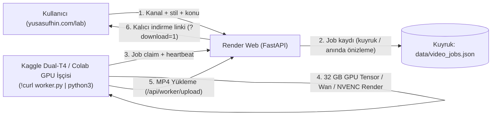
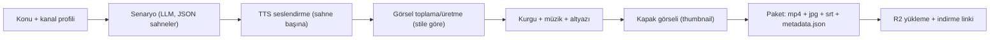
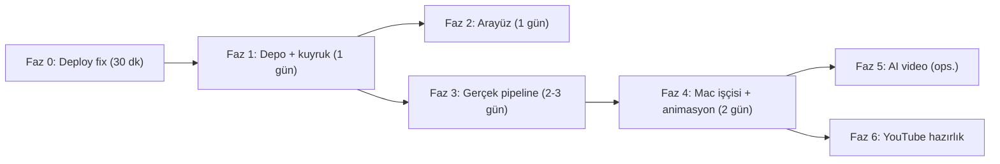

# yusasufhin.com — Esnek Video Fabrikası: Tespit + Uygulama Planı

> **Kime:** Bu planı uygulayacak yapay zeka ajanı.
> **Proje kökü:** `/Users/yusufsahin/Desktop/Fabrika_Products/yusasufhin_cockpit/` (GitHub `sufhinyusa/yusasufhin-cockpit`, `main` dalı → Render)
> **Hedef:** Siteden kanal ve stil seçip (animasyon / sinematik / shorts / AI-video) **gerçek, yayına uygun MP4** üretmek; iş bitince sitede **kalıcı indirme linki** görünmesi. YouTube'a yükleme **bu planın kapsamı dışında** (en son Faz 6'da hazırlık var).

---

## 0. Ajan için bağlayıcı kurallar

1. **Kural 3:** Tüm kod yalnız `yusasufhin_cockpit/` içinde yazılır. `PYTHON PROJECTS/Fabrika/` reposuna **dokunma**.
2. **Kural 1 (dürüstlük):** Gerçek prodüksiyon olmayan her çıktı `status` alanında **"(simülasyon)"** taşır. Uydurma metrik (ör. "48 GB VRAM", "%99.99 SLA") YASAK; bilinmiyorsa `"Doğrulanmadı"`.
3. **Kural 0:** Geçici dosyalar yalnız `temp/` altına (repo içinde `temp/` oluşturup `.gitignore`'a ekle). İş bitince temizle.
4. **Kural 2:** Küçük paketler. Yeni özellik = yeni modül (100–300 satır). `main.py` (1491 satır) daha da büyütülmez; aksine router'lara bölünür.
5. Her faz sonunda: `pytest tests/` %100 geçer → commit → push → **canlıda doğrula** (bkz. Faz 0).

---

## 1. Tespit — canlı site ve kodda neler eksik / yanlış

Ölçüm tarihi: 2026-11-10. Kanıtlar `curl` ile alındı.

### 🔴 P0 — Kritik (önce bunlar)

| # | Sorun | Kanıt | Etki |
|---|---|---|---|
| 1 | **Canlı site eski kodu çalıştırıyor.** Son 3 commit (`e6debc9`, `ff5b47e`, `53e0e48`) Render'a deploy edilmemiş. | `https://yusasufhin.com/sw.js` → `fabrika-pwa-v9-studio` (yerelde `v10`); canlı `lab.js` içinde `refreshStudioMediaLists` / `Sesi İndir` **0 eşleşme**; canlı `/api/auth/public_info` hâlâ `cluster_vram_gb: 48.0`, `uptime_sla: 99.99%` diyor (yerel: `0.0`, `Doğrulanmadı`). | Kullanıcı yaptığımız hiçbir düzeltmeyi görmüyor. İndirme linki "yok" gibi görünüyor. |
| 2 | **Render diski geçici (ephemeral).** Videolar `static/media/` ve iş kayıtları `data/*.json` diskte tutuluyor. | `studio_controller.py` → `self.media_dir = static/media`; `data/video_jobs.json`. | Her deploy/yeniden başlatma/uyku sonrası **tüm videolar ve geçmiş silinir** → indirme linkleri 404 olur. |
| 3 | **Video üretimi HTTP isteğinin içinde senkron.** `POST /api/studio/video/generate` ffmpeg bitene kadar bekliyor. | `main.py:L769+` → `create_video_job(...)` doğrudan çağrılıyor; `Procfile` → `--workers 1`. | Uzun (60 sn+) videolarda Cloudflare 100 sn zaman aşımı → 524 hatası; tek worker kilitlenir, site donar. |
| 4 | **Üretilen "video" aslında 5 sn renk zemini + başlık + bip sesi.** | `Video_Nerede_Kok_Neden_2026-11-10.md`: 4 yöntemin hepsi 5.0 s önizleme. Remotion/Blender/Wan projeleri yalnız **dosya olarak yazılıyor, hiç çalıştırılmıyor**. | YouTube'a konacak içerik yok. |
| 5 | **Render'da GPU yok, RAM ~512 MB (free).** | Render free plan. | AI video (Wan/LTX), Remotion (Chromium) ve Blender Render üzerinde **çalışamaz**. Ağır işler ayrı bir işçiye taşınmalı. |

### 🟠 P1 — Önemli

| # | Sorun | Detay |
|---|---|---|
| 6 | Oturumlar bellekte (`ACTIVE_SESSIONS` dict) | Render yeniden başlayınca herkes çıkış yapar. |
| 7 | Medya URL'lerinde `?token=<oturum_tokenı>` | Token tarayıcı geçmişine/loglara sızar. Kısa ömürlü **imzalı indirme URL'si** kullanılmalı. |
| 8 | İki ayrı, çakışan video akışı | Sekme 1 (`/api/studio/video/generate`) ve Sekme 6 (`/api/lab/generate`, "Wan Studio") ayrı formlar, ayrı alanlar. Kullanıcı hangisini kullanacağını bilmiyor. |
| 9 | İş durumu takibi yok | Kuyruk/ilerleme/yeniden deneme/iptal yok; sayfa yenilenince süreç kaybolur. |
| 10 | Kanal tanımları kodda sabit | `studio_controller.py:L425` ve `main.py:L750` — 2 kanal hardcoded. Birden fazla YouTube kanalı için **kanal profili** (stil, ses, oran, intro/outro, dil) yönetilemiyor. |
| 11 | Senaryo / seslendirme / altyazı / görsel yok | Pipeline'ın içerik katmanı (LLM senaryo, TTS, stok görüntü, altyazı) hiç yok. |
| 12 | `.gitignore` eksik | `static/media/*.wav`, `data/*_jobs.json`, `temp/` yok → repo kirlenir. |

### 🟡 P2 — Bakım / kalite

| # | Sorun |
|---|---|
| 13 | `main.py` monolit (1491 satır, 40+ endpoint). Router'lara bölünmeli: `routers/auth.py`, `routers/video.py`, `routers/audio.py`, `routers/media.py`, `routers/misc.py`. |
| 14 | `lab.js` 1174 satır, global fonksiyonlar + IIFE karışık (yakın zamanda `token is not defined` hatası buradan çıktı). Modüllere bölünmeli. |
| 15 | `@app.on_event` deprecated → `lifespan`. |
| 16 | DNS/origin belirsizliği: `~/.cloudflared/config.yml` hâlâ `yusasufhin.com → Mac:34891` diyor, ama canlı yanıt Render'dan (`x-render-origin-server: uvicorn`). Tek kaynak seçilmeli (öneri: site = Render, Mac = işçi). |

---

## 2. Hedef mimari & Kaggle/Colab GPU Köprüsü (Uygulandı)



### ⚡ Ücretsiz ve Kaliteli Render Nasıl Sağlanıyor? (Link #226)
1. **Kaggle 30 Saat/Hafta Ücretsiz Dual-T4 (32 GB vRAM):**
   - Kullanıcı Kaggle veya Google Colab'da `Fabrika_GPU_Renderer.ipynb` dosyasını açar (veya tek satır kod çalıştırır: `!curl -sS https://yusasufhin.com/worker.py | python3`).
   - İşçi `POST /api/worker/heartbeat` ile sunucuya bağlanır. Panelde anında **`🟢 Kaggle Dual-T4 Bağlı (32.0 GB vRAM)`** görünür.
   - İşçi sıradaki işi `GET /api/worker/claim` ile alır, GPU'da yüksek çözünürlüklü render eder (NVENC veya Wan difüzyon) ve biten MP4'ü `POST /api/worker/upload` ile sunucuya yükler.
2. **Kaggle/Colab Kapalıyken (Akıllı Çift Motor - Anında Nöral Seslendirme):**
   - Kullanıcı işçi açmadan hemen video indirmek isterse, sistem **Google Gemini 2.5 Nöral TTS** (`gemini-2.5-flash-preview-tts` / `gemini-2.5-pro-preview-tts`) ile gerçek yüksek kaliteli seslendirme (`Aoede`, `Puck`, `Charon`, `Kore`, `Fenrir`) ve dinamik kurgu ile **5-10 saniyede gerçek sesli 1080p MP4** üretir.
   - İş kuyrukta GPU için de saklanır; Kaggle açıldığında otomatik olarak GPU ile 4K/AI olarak yükseltilir.

---

## 3. Video stilleri (esnek motor)

Her stil = bir **preset** (`presets/<ad>.json`) + bir **renderer**. Yeni stil eklemek kod değil, preset eklemek olmalı.

| Stil anahtarı | Ne üretir | Görsel kaynağı | Kurgu motoru | Nerede çalışır |
|---|---|---|---|---|
| `cinematic_stock` | Belgesel / sinematik anlatım | Pexels + Pixabay stok video/foto (ücretsiz API) | ffmpeg: Ken Burns, crossfade, renk LUT, letterbox, müzik ducking | Render (hızlı) + Mac |
| `animation_2d` | Açıklayıcı animasyon, kinetik tipografi, ikon/şekil animasyonu | Kod ile çizim (SVG/şekil/ikon) | **Remotion** (React) şablonları | Mac (Node + Chromium) |
| `motion_infographic` | Veri/istatistik/liste videoları | Grafik + sayaç animasyonları | Remotion | Mac |
| `shorts_vertical` | 9:16, ≤ 60 sn, büyük altyazı, hızlı kesim | Stok veya diğer stillerden kesit | ffmpeg + kelime-kelime altyazı (ASS) | Render + Mac |
| `ai_generative` | Metinden AI video klipleri (sahne başına 3–5 sn) | Wan 2.x / LTX-Video | ComfyUI veya diffusers | Kaggle/Colab GPU (opsiyonel, Faz 5) |
| `slideshow_quote` | Alıntı/astroloji kartları, sakin anlatım | AI görsel veya stok foto | ffmpeg | Render |

**Ortak pipeline (tüm stiller):**



- **Senaryo:** mevcut `/api/omniroute/generate` altyapısı kullanılır; çıktı **zorunlu JSON şeması**: `{title, description, tags[], scenes:[{text, visual_query, duration_hint, on_screen_text}]}`. Şema doğrulanmazsa 2 kez yeniden dene, sonra dürüst hata.
- **TTS:** Google Gemini 2.5 Nöral TTS (`gemini_audio.py`, ses profilleri: `Aoede`, `Puck`, `Charon`, `Kore`, `Fenrir`). Microsoft Edge yasaklanmıştır. Sahne süresi = TTS süresi + 0.4 sn.
- **Altyazı:** TTS metninden doğrudan SRT (zamanlar TTS sürelerinden). Kelime-kelime shorts altyazısı için `faster-whisper` (Mac işçisi).
- **Müzik:** telifsiz parçalar `assets/music/<mood>/` (kullanıcı ekler) + ffmpeg `sidechaincompress` ile ses altında otomatik kısma.
- **Kapak:** Pillow ile 1280×720 — en iyi kare + başlık + kanal rengi.

---

## 4. Veri modeli

Kalıcı DB öneri: **Turso (libSQL/SQLite, ücretsiz katman)** veya **Supabase Postgres (ücretsiz)**. Erişim katmanı `SQLAlchemy` ile soyutlansın; yerelde `sqlite:///temp/dev.db`.

```text
ChannelProfile
  id (slug, ör. "astroloji_kova"), name, language ("tr"), default_style,
  aspect_ratio ("16:9"|"9:16"), voice ("tr-TR-AhmetNeural"), voice_rate,
  brand_color, font, intro_asset_key?, outro_asset_key?, music_mood,
  target_duration_sec, prompt_prefix (kanal tonu), created_at

VideoJob
  id ("VJ-<ulid>"), channel_id, style, topic, options_json,
  status: queued|claimed|scripting|tts|visuals|composing|uploading|done|failed|cancelled,
  progress_pct, stage_log_json, error?, worker_id?, attempts,
  is_simulation (bool), created_at, started_at, finished_at

VideoAsset
  id, job_id, kind: video|thumbnail|subtitle|metadata|zip,
  storage_key (R2), size_bytes, duration_sec?, width?, height?, sha256, created_at
```

---

## 5. API sözleşmesi (yeni `routers/video.py`)

| Metot | Yol | Açıklama |
|---|---|---|
| `GET` | `/api/channels` | Kanal profilleri listesi |
| `POST/PUT/DELETE` | `/api/channels[/{id}]` | Kanal profili yönetimi (auth) |
| `GET` | `/api/video/styles` | Preset listesi (ad, açıklama, desteklenen oranlar, nerede çalışır, işçi gerekiyor mu) |
| `POST` | `/api/video/jobs` | İş oluştur → **anında** `{job_id, status:"queued"}` döner (render beklenmez) |
| `GET` | `/api/video/jobs?channel=&status=&page=` | İş listesi (sayfalı) |
| `GET` | `/api/video/jobs/{id}` | Durum + aşamalar + asset listesi |
| `GET` | `/api/video/jobs/{id}/events` | SSE canlı ilerleme (yedek: 3 sn polling) |
| `POST` | `/api/video/jobs/{id}/cancel` / `/retry` | İptal / yeniden dene |
| `GET` | `/api/video/jobs/{id}/download?kind=video\|thumbnail\|subtitle\|zip` | **302 → R2 imzalı URL** (15 dk geçerli, `Content-Disposition: attachment`) |
| `POST` | `/api/worker/claim` | İşçi sıradaki işi alır (header `X-Worker-Key`) |
| `POST` | `/api/worker/jobs/{id}/progress` | İşçi ilerleme bildirir |
| `POST` | `/api/worker/jobs/{id}/complete` / `/fail` | İşçi sonucu bildirir (asset anahtarları ile) |
| `GET` | `/api/worker/status` | Son heartbeat'e göre işçi çevrimiçi mi (UI'da gösterilir) |

Eski uçlar (`/api/studio/video/generate`, `/api/lab/generate`, `/api/lab/history`) yeni sisteme **ince adaptör** olarak yönlendirilir, sonra kaldırılır.

---

## 6. Uygulama fazları

### Faz 0 — Deploy'u düzelt (≈ 30 dk) 🔴

1. Render panelinde servisin **Auto-Deploy = Yes** ve branch = `main` olduğunu doğrula; değilse aç. **Manual Deploy → Deploy latest commit** yap. *(Panel erişimi kullanıcıdadır; ajan yapamıyorsa kullanıcıdan iste.)*
2. `GET /api/version` ekle → `{"commit": os.environ.get("RENDER_GIT_COMMIT"), "built_at": ...}`. Sitenin altbilgisinde göster.
3. `.gitignore` ekle: `static/media/*.wav`, `data/*_jobs.json`, `temp/`, `*.db`.
4. **Kabul:** `curl https://yusasufhin.com/api/version` → son commit hash'i; `sw.js` → `v10`; canlı `public_info` → `cluster_vram_gb: 0.0`.

### Faz 1 — Kalıcı depolama + iş kuyruğu iskeleti (≈ 1 gün) 🔴

1. `storage.py`: `put_file(local_path, key)`, `presigned_url(key, filename, ttl=900)`, `delete(key)`. Backend: **Cloudflare R2** (S3 uyumlu, `boto3`). Env: `R2_ACCOUNT_ID`, `R2_ACCESS_KEY_ID`, `R2_SECRET_ACCESS_KEY`, `R2_BUCKET`. Yerel geliştirmede `LocalStorage` (`temp/storage/`).
2. `db.py` + `models.py`: Bölüm 4'teki tablolar. Env: `DATABASE_URL`.
3. `routers/video.py`: Bölüm 5 uçları (işçi uçları dahil). `X-Worker-Key` = env `WORKER_KEY`.
4. Oturumları DB'ye taşı (P1-6).
5. Mevcut 5 sn önizleme üreticisini (`studio_controller.create_video_job`) **geçici işçi** olarak sar: Render'da `asyncio` arka plan task'ı işi alır → üretir → R2'ye yükler → `done`. `is_simulation=True`, status `"done (simülasyon önizleme)"`.
6. **Kabul:** İş oluştur → 1 sn içinde `queued` döner → ≤ 30 sn'de `done` → indirme linki çalışır → **Render'ı yeniden başlat → link hâlâ çalışır.**

### Faz 2 — Arayüz: tek "Video Fabrikası" ekranı (≈ 1 gün) 🟠

`static/lab.html` Sekme 1 ve Sekme 6 **tek ekranda birleşir**. `lab.js` → `static/js/video_factory.js` (yeni modül, ≤ 300 satır).

- **Form:** Kanal (dropdown, kanal profilinden oran/ses/stil otomatik dolar) · Stil (kartlar, her kartta küçük örnek GIF + "İşçi gerekir" rozeti) · Konu/prompt · Süre (30 sn / 60 sn / 3 dk / 8 dk) · Oran (16:9 / 9:16 / 1:1) · Ses (kadın/erkek, hız) · Altyazı aç/kapa · Müzik ruh hali · Kalite (Hızlı 720p / Standart 1080p).
- **İş kartı (canlı):** aşama çubuğu (Senaryo → Ses → Görsel → Kurgu → Yükleme), yüzde, süre, log satırları, İptal/Yeniden dene.
- **Kütüphane:** kanala/stile/tarihe göre filtreli ızgara; her kartta oynatıcı (imzalı URL), **⬇️ MP4**, **⬇️ Kapak**, **⬇️ SRT**, **⬇️ Paket (ZIP)**, "Başlık/açıklama/etiketleri kopyala" butonu, simülasyon rozeti.
- **Üst bant:** İşçi durumu (🟢 Mac işçisi çevrimiçi / ⚪ çevrimdışı — yalnız hızlı mod).
- **Kanal Yönetimi** paneli: kanal ekle/düzenle (Bölüm 4 alanları).
- **Kabul:** Telefon (Safari) ve masaüstünde üret → kartta canlı ilerleme → bitince indirme butonu çalışır, dosya cihaza iner.

### Faz 3 — Gerçek içerik pipeline'ı (≈ 2–3 gün) 🔴

Yeni paket: `pipeline/` (her dosya ≤ 300 satır)

| Modül | Görev |
|---|---|
| `pipeline/script.py` | LLM'den JSON senaryo (şema doğrulama + 2 yeniden deneme) |
| `pipeline/tts.py` | Google Gemini 2.5 Nöral TTS, sahne başına wav + süre ölçümü (`ffprobe`) |
| `pipeline/visuals_stock.py` | Pexels/Pixabay arama (`visual_query`), oran uygun klip seçimi, indirme önbelleği (`temp/cache/`) |
| `pipeline/subtitles.py` | SRT + ASS (shorts için büyük, ortalı, vurgulu) |
| `pipeline/compose_ffmpeg.py` | Sahne kurgusu: Ken Burns, crossfade, LUT, metin katmanı, müzik ducking, loudness `-14 LUFS` (YouTube standardı) |
| `pipeline/thumbnail.py` | Pillow ile kapak |
| `pipeline/package.py` | `metadata.json` (title/description/tags/chapters) + ZIP |
| `pipeline/runner.py` | Stil → adım sırası; her adımda `progress` bildirimi; hata = `failed` + sebep |
| `presets/*.json` | Bölüm 3 stilleri (`cinematic_stock`, `shorts_vertical`, `slideshow_quote` ilk üç) |

- Env: `PEXELS_API_KEY`, `PIXABAY_API_KEY`, `LLM_*` (mevcut OmniRoute).
- Bu fazda **gerçek prodüksiyon** olduğu için `is_simulation=False`. Görsel bulunamazsa → düz renk + metin yedeği ve o sahne `simülasyon` olarak işaretlenir (dürüstlük).
- **Kabul:** "Kova burcu Kasım 2026" konusuyla `cinematic_stock` 60 sn 1080p → seslendirmeli, altyazılı, müzikli, ≥ 6 farklı sahne; `ffprobe` h264+aac, ses −14 LUFS ±1; shorts 9:16 versiyonu ayrıca üretilir.

### Faz 4 — Mac video işçisi + animasyon stilleri (≈ 2 gün) 🟠

1. `worker/worker.py` (repo içinde, Mac'te çalışır): `POST /api/worker/claim` ile iş al → `pipeline.runner` → R2'ye yükle → `complete`. 30 sn heartbeat. Ağ kesilirse kaldığı yerden devam.
2. `worker/install_mac.sh`: venv, `pip install -r worker/requirements.txt`, Node 20 + `npm i` (Remotion), LaunchAgent `com.yusasufhin.videoworker.plist` (**dikkat:** Fabrika'nın `com.fabrika.gateway` servisiyle çakışmasın; port kullanmaz, yalnız giden HTTPS).
3. `remotion/` alt projesi: `ExplainerAnimation`, `KineticTypography`, `Infographic` kompozisyonları; props = senaryo JSON. `npx remotion render` işçi tarafından çağrılır.
4. Presetler: `animation_2d`, `motion_infographic`.
5. Render'daki yedek arka plan işçisi yalnız "hızlı" ve Remotion gerektirmeyen stilleri alır; diğerleri Mac işçisini bekler (UI'da "İşçi bekleniyor" dürüst durumu).
6. **Kabul:** Mac işçisi açıkken `animation_2d` 60 sn video üretilir ve siteden indirilir; işçi kapatılınca UI ⚪ gösterir, iş `queued` kalır, açılınca otomatik işlenir.

### Faz 5 — AI üretken video (opsiyonel, ≈ 2–3 gün) 🟡

- `worker/kaggle/` notebook: aynı `claim/complete` protokolü; Wan 2.x veya LTX-Video ile sahne başına 3–5 sn klip → Mac/Render kurgusuna asset olarak döner.
- Kaggle haftalık GPU kotası ve model lisansları **uygulamadan önce doğrulanmalı (Doğrulanmadı)**.
- `ai_generative` preseti: AI klip + TTS + altyazı.

### Faz 6 — YouTube'a hazırlık (bağlamadan önce) 🟡

- Her kanal profiline `youtube_channel_id?` alanı (boş). Paket `metadata.json` YouTube Data API `videos.insert` gövdesiyle birebir uyumlu formatta olsun (title ≤ 100, description ≤ 5000, tags toplam ≤ 500 karakter, `categoryId`, `defaultLanguage`).
- Toplu üretim: "Bu kanal için 5 konu öner → 5 iş oluştur" butonu.
- Zamanlayıcı (günlük X video) **Faz 6 sonrası** ayrı plan.

---

## 7. Test planı (her faz için `tests/` altına)

| Test dosyası | Kapsam |
|---|---|
| `tests/test_storage.py` | LocalStorage put/presign/delete; imzalı URL süresi |
| `tests/test_jobs_api.py` | İş oluştur anında döner; durum geçişleri; iptal/yeniden dene; yetkisiz erişim 401 |
| `tests/test_worker_protocol.py` | Yanlış `X-Worker-Key` → 403; iki işçi aynı işi alamaz (atomik claim); heartbeat zaman aşımı → iş tekrar `queued` |
| `tests/test_pipeline_script.py` | Bozuk LLM JSON → yeniden deneme → dürüst hata (LLM mock) |
| `tests/test_pipeline_compose.py` | 3 sahnelik mini video (renk + sessiz TTS mock) → ffprobe ile süre/codec/çözünürlük doğrulama |
| `tests/test_honesty.py` | Önizleme/yedek sahnelerde `simülasyon` etiketi zorunlu; `public_info`'da uydurma metrik yok |
| Mevcut `tests/test_cockpit_app.py` | Kırılmamalı (16/16) |

---

## 8. Ortam değişkenleri (Render + Mac işçisi)

```bash
DATABASE_URL=            # Turso/Supabase
R2_ACCOUNT_ID= R2_ACCESS_KEY_ID= R2_SECRET_ACCESS_KEY= R2_BUCKET=yusasufhin-media
WORKER_KEY=              # uzun rastgele değer; Render + Mac işçisinde aynı
PEXELS_API_KEY= PIXABAY_API_KEY=
FABRIKA_GATEWAY_PASSWORD= GATEWAY_PIN=   # mevcut
```
Sırlar **asla** repoya yazılmaz; `.env.example` dosyası yalnız anahtar adlarını içerir.

---

## 9. Riskler

| Risk | Önlem |
|---|---|
| Render free uyku (15 dk boşta kalınca) → işçi claim isteği ilk seferde yavaş | İşçi claim'de 60 sn timeout + tekrar deneme |
| Stok görsel API kota/limitleri | `temp/cache/` önbellek; Pexels + Pixabay dönüşümlü kullanım |
| Telif (müzik/görsel) | Yalnız Pexels/Pixabay lisanslı içerik + kullanıcının eklediği telifsiz müzik; `metadata.json`'a kaynak/atıf listesi |
| R2 ücretsiz katman sınırı | 30 günden eski ve indirilmiş ham dosyaları silen temizlik görevi (opsiyonel ayar) |
| Mac uykuya geçince işçi durur | `caffeinate -i` ile işçiyi sar; UI'da dürüst ⚪ durumu |

---

## 10. Önerilen sıra ve tahmini süre



**Minimum çalışan ürün (MVP) = Faz 0 + 1 + 2 + 3** → siteden kanal/stil seç → gerçek seslendirmeli, altyazılı sinematik veya shorts video → kalıcı indirme linki.
